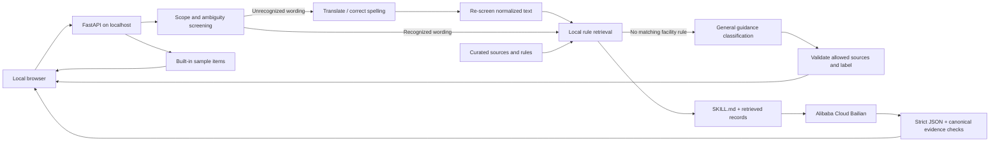

# Architecture

The server loads versioned JSON records on startup from `data/rules.json`, `data/sources.json` and `data/general-guidance.json`. `SKILL.md` is incorporated into the system instruction for live model decisions. The transport requests JSON output, bounds tokens and timeouts, disables automatic retries and redirects, and enforces one active provider request at a time. The API key remains on the server and is never exposed to the browser.

Retrieval is lexical and deterministic, matching item phrases, materials and required conditions without requiring a vector database or embedding calls. All matching rules are checked for conflict before calling the model. General background sources cannot establish HKU facility acceptance.

When local matching does not recognize a typo or non-English description, a constrained normalization call translates or corrects the input into English. The normalized text is schema-validated and passed back through the same deterministic safety screen and rule retrieval. The normalizer is instructed not to add missing material, cleanliness or preparation facts.

For facility rules, the model selects one applicable rule or abstains (`cannot_determine`). A supported answer must match that rule's canonical decision, facility, preparation steps, reason and source identifiers. The backend validates these fields against the trusted local record before returning the response.

## HTTP endpoints

| Method/path | Contract |
| --- | --- |
| `GET /` | Local application HTML. |
| `GET /static/...` | Browser static assets (`app.js`, `styles.css`, `favicon.svg`). |
| `GET /api/config` | Provider/model metadata, live readiness, corpus version and privacy notice (never the API key). |
| `GET /api/samples` | Built-in sample items. |
| `GET /api/corpus` | Active rule records and cited reference metadata. |
| `POST /api/check` | `{mode, description, sample_id?}`; response conforms to `schemas/answer.schema.json`. |

`status` is `accepted`, `not_accepted`, `cannot_determine`, `general_guidance` or `refused`. `mode` is `sample`, `screening` or `live`. Operational errors return a non-2xx HTTP status with `{error: {code, message}}`.
