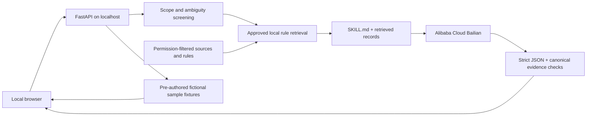

# Architecture

The server loads versioned JSON records on startup and selects rules explicitly included by the project team with valid official references. It accepts either a documented `approved` status or the explicit `team_override` chosen for this course prototype. Research candidates are in a separate file that the application never reads. `SKILL.md` is read and incorporated into the system instruction for actual provider requests. The transport requests JSON, bounds tokens/time, disables retries and redirects, and permits one request at a time. The course API key never enters frontend configuration.

Retrieval is lexical and inspectable, using item phrases, material and conditions. It is retrieval-augmented generation without embeddings: suitable for a small approved pilot collection, with no hidden vector index or embedding charges. All matching rules must be considered for conflict before narrowing the provider context. General background sources cannot establish facility acceptance.

The model selects a single approved rule or abstains. A supported answer must match that rule's decision, facility, preparation, reason and source identifiers. The server assembles evidence from trusted records and displays the canonical fields. This intentionally constrains the model's freedom: it tests record selection and faithful use of evidence, not free-form recycling expertise. Unknown source IDs, invented recommendations and truncated/invalid outputs are errors. The server supplies a safe fixed explanation for model abstention rather than displaying uncontrolled disposal advice.

The sample route accepts only a known sample ID and its unchanged authored description. It cannot classify arbitrary input, and every sample response identifies its mode. The acceptance/rejection fixtures concern an imaginary facility, not HKU. Deterministic screening responses identify themselves separately from model-generated results.

## HTTP endpoints

| Method/path | Contract |
| --- | --- |
| `GET /` | Local application HTML. |
| `GET /static/...` | Only the browser asset directory. Source data and `.env` are not static assets. |
| `GET /api/config` | Public provider/model identity, live readiness, corpus metadata and privacy notice; never the key. |
| `GET /api/samples` | Supplied authored examples. |
| `GET /api/corpus` | Approved context and separately labelled reference metadata. Pending references are not model evidence. |
| `POST /api/check` | `{mode, description, sample_id?}`; output follows `schemas/answer.schema.json`. |

`status` is `accepted`, `not_accepted`, `cannot_determine` or a separate `refused` safety outcome. `mode` is `sample`, `screening` or `live`. Operational errors use a non-2xx status and `{error: {code, message}}`; they never masquerade as a recycling decision. Request validation errors do not echo rejected inputs or secrets.

Bind to loopback only and keep one worker. This app is a local course handoff, not a multi-user hosted service. Do not expose it through a public tunnel without addressing account access, rate limiting and deployment requirements.
